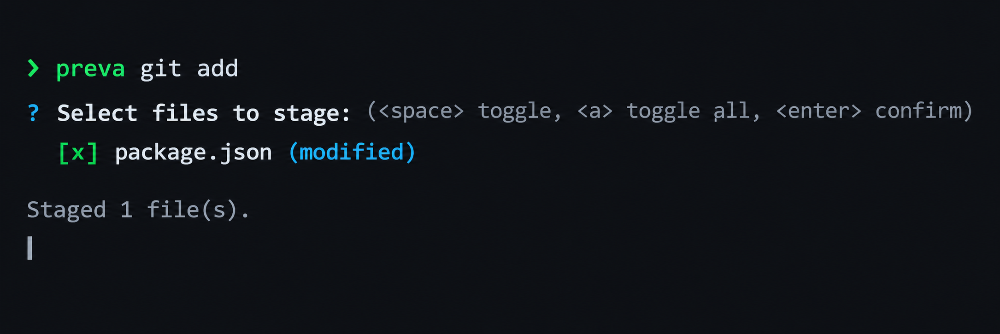
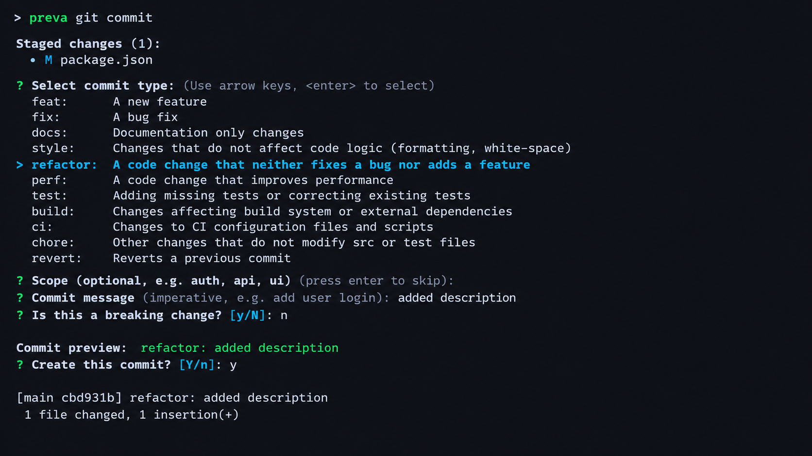
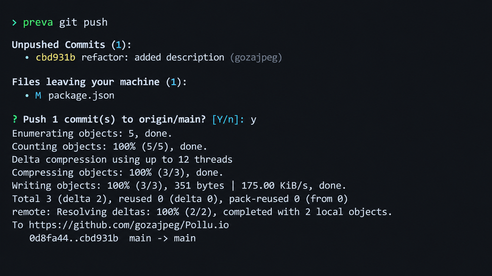

<div align="center">
  
  <h1>preva</h1>
  <p><strong>Same Git, just with a preview.</strong></p>
  <p>Preva doesn't change how Git works. It just shows you what's happening before you stage, commit, or push, so you can catch mistakes before they leave your machine.</p>

  <p>
    <a href="https://nodejs.org"></a>
    <a href="https://www.npmjs.com/package/preva-cli"></a>
    <a href="LICENSE"></a>
    <a href="https://github.com/gozajpeg"></a>
  </p>
</div>

---

### Overview

Preva doesn't change how Git works. It runs normal Git commands, but gives you a preview first so you don't push the wrong files by accident:

1. **Interactive Staging (`preva add`)**: Pick which files to stage from a checklist instead of running `git add .` blindly. Common secret files like `.env` start unchecked.
2. **Conventional Commits (`preva commit`)**: Pick standard commit types (`feat`, `fix`, `docs`, etc.) to keep your commit history clean and consistent.
3. **Pre-Push Review (`preva push`)**: See your unpushed commits and the exact files you're about to push, with an alert if any secret files got committed.

---

### Terminal Previews

#### 1. Interactive Staging (`preva git add .`)

Instead of staging everything blindly with `git add .`, run:

```bash
preva git add .
# or shorthand:
preva add .
```

`preva` scans your repository changes and displays an interactive checklist:



- **Normal changes** start pre-checked so common staging stays fast.
- **Sensitive files** (patterns like `*.key`, `*.pem`, `.env*`, `credentials.json`, `*.p12`) start **unchecked** by default.
- Use **arrow keys** or **j/k** to navigate, **Space** to toggle, **a** to toggle all, and **Enter** to confirm.
- Only the files you confirm will be staged with native `git add`.

You can also target specific folders or paths:

```bash
preva git add src/
preva git add config/
```

---

#### 2. Conventional Commit Generator (`preva git commit`)

Write clean, consistent Conventional Commits with interactive selectable types and pre-filled formatting:

```bash
preva git commit
# or shorthand:
preva commit
```

`preva` reviews your staged changes, lets you select standard commit types, prompts for an optional scope, and previews the formatted message:



- **Standard Types**: Pre-fills the 11 standard types from Conventional Commits v1.0.0 and `@commitlint/config-conventional`.
- **Automatic Formatting**: Normalizes scopes to lowercase and auto-strips trailing periods so commits pass CI linters without friction.
- **Breaking Changes**: Automatically appends the standard exclamation mark `!` (e.g. `feat(api)!: remove v1 endpoint`) when a breaking change is confirmed.
- **Safety**: Warns if nothing is staged and suggests running `preva git add .` first.
- **Flag Pass-through**: Passes through native Git commit flags (e.g. `preva commit --amend` or `preva commit -m "custom message"`).

---

#### 3. Pre-Push Review (`preva git push`)

Before pushing your branch, run:

```bash
preva git push origin main
# or shorthand:
preva push
```

`preva` inspects the unpushed commits and presents a clear summary:



- If flagged files are detected, the confirmation prompt defaults to **No (`[y/N]`)**.
- Pressing **n**, **Enter**, or **Ctrl+C** cleanly cancels the push without sending anything to the remote.
- When cancelled, `preva` prints the command to uncommit the file if you need to adjust it:
  ```bash
  To uncommit and adjust before pushing:
     git reset --soft HEAD~1
     preva git add .
     preva commit
  ```

---

### What `preva` Flags

1. **Common Sensitive Patterns:** Identifies common credential and key formats by filename (`.env*`, `*.pem`, `*.key`, `id_rsa*`, `credentials.json`, `*.p12`, `*.keystore`, `*.p8`, `*.ovpn`, `.npmrc`, `.pypirc`).
2. **Tracked `.gitignore` Matches:** Flags files that match your project's `.gitignore` rules but are still being tracked because they were committed previously.
3. **Heavy Directories:** Highlights unignored directories such as `node_modules/` or `dist/` before they are staged.
4. **Renamed and Deleted Files:** Distinguishes renames (`R`) and deletions (`D`) in the checklist.

---

### Boundaries (What `preva` Is Not)

- **Not a Secret Scanner:** `preva` checks file names and paths against known patterns. It does not scan inside file contents for hardcoded tokens or API keys.
- **No Automatic History Alterations:** `preva` will never automatically rebase, reset, or amend commits for you.
- **No Native Git Interception:** It does not install Git hooks. Plain `git add` and `git push` will continue to run without `preva` unless explicitly invoked.

---

### Installation & Usage

Install globally via npm:

```bash
npm install -g preva-cli
```

Or run directly with `npx`:

```bash
npx preva-cli git add .
```

#### Commands

| Command | Description |
|---|---|
| `preva git add .` | Review all changes in an interactive checklist before staging |
| `preva git add <paths...>` | Review specific files or folders before staging |
| `preva git commit` | Interactive Conventional Commit generator with selectable types |
| `preva git push [remote] [branch]` | Review unpushed commits and files before pushing |
| `preva --version` | Show installed version |
| `preva --help` | Show usage help and options |

---

### Non-Interactive Environments & CI

When run in environments without an interactive TTY (`!process.stdin.isTTY`):
- `preva` detects the missing terminal and exits cleanly with code `1` rather than hanging.

| Exit Code | Meaning |
|---|---|
| `0` | Success: files staged or commits pushed |
| `1` | Error: not a git repo, no changes, or non-interactive terminal |
| `130` | Cancelled by user (`Ctrl+C` or chose `N`) |

---

### Design Philosophy

- **Zero External Dependencies:** Built entirely with Node.js standard library built-ins (`node:readline`, `node:child_process`, `node:fs`, `node:path`).
- **Zero Extra Config Files:** No `.prevaignore` dotfiles required. Works using built-in patterns and your project's `.gitignore`.
- **Defensive Execution:** Runs native Git commands using `execFile` with argument arrays and `--` path separators to avoid shell quoting and flag injection issues.

---

### License

MIT License © [gozajpeg](https://github.com/gozajpeg)
